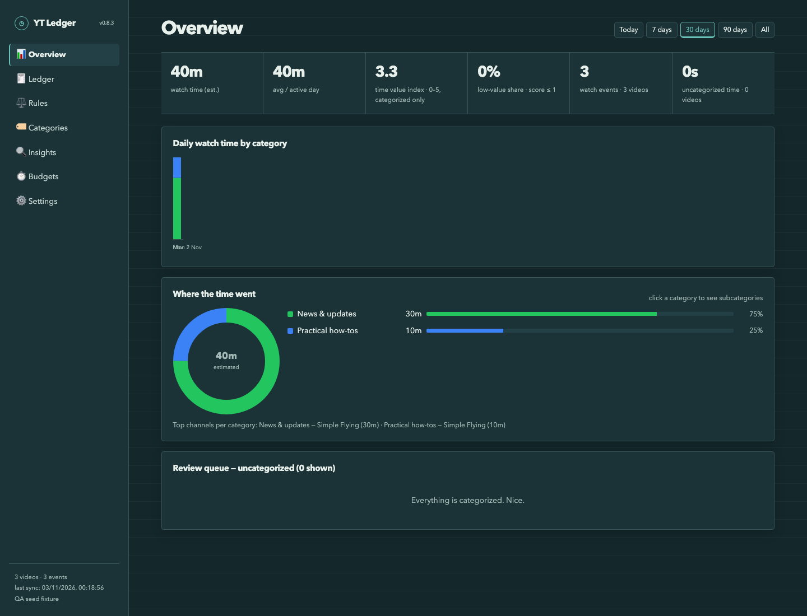
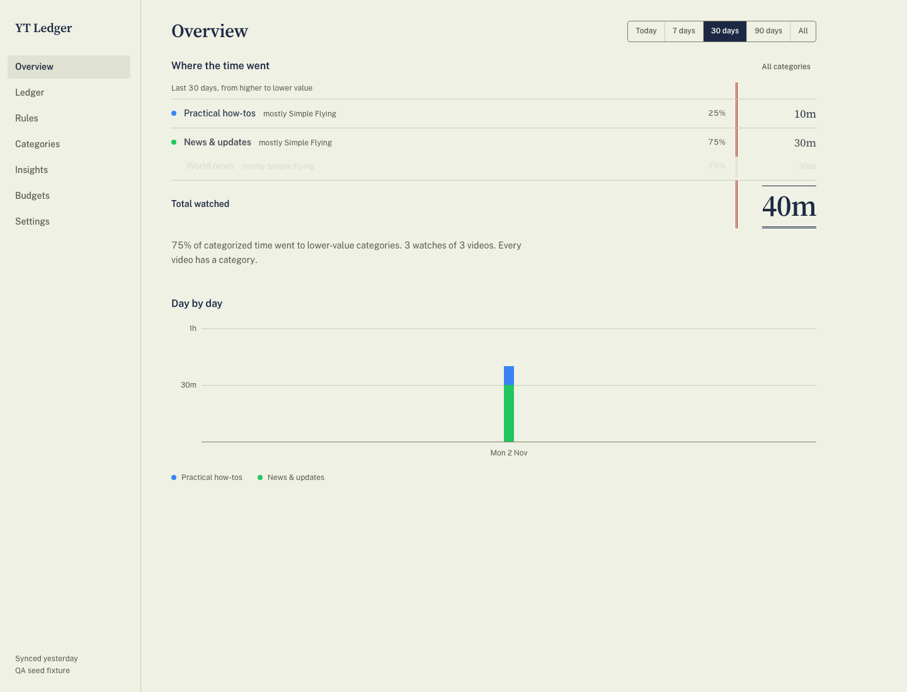
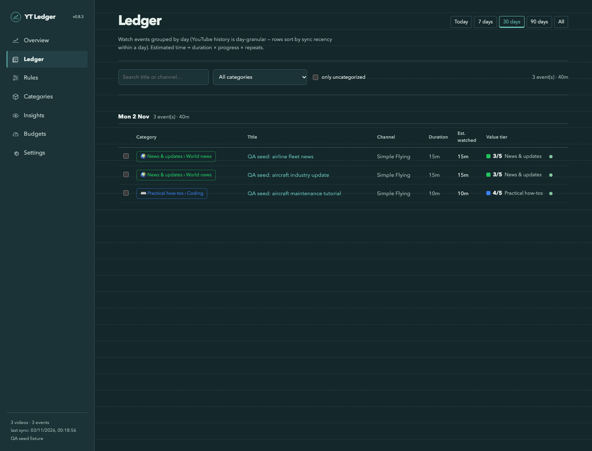

# YT Ledger

**An expense manager for your YouTube watch time.** Categorize what you watch, see where the hours go, and set budgets YouTube itself will respect.



<p align="center">
  
  
</p>

## Why

Expense trackers work because they make spending visible: every transaction lands in a category, and the totals tell you something you didn't want to hear. YT Ledger does the same for YouTube. Each video in your watch history becomes a ledger entry, and each category sits on a value ladder from *brain rot* (0) to *courses & lectures* (5). It's not about watching less. It's about knowing what the time actually went to.

YT Ledger is a Chromium browser extension (Manifest V3, built with [Plasmo](https://www.plasmo.com/)). Everything stays in your browser.

## Features

- **Value-scored categories.** Eight default categories scored 0–5, from *Brain rot* through *News & updates* and *Practical how-tos* to *Courses & lectures*. Rename, recolor, rescore, reorder or archive any of them.
- **Subcategories.** Editable subcategories under every category (e.g. *Practical how-tos › Coding*), with sensible defaults. Charts show top-level categories and drill down in place.
- **Auto-categorization rules.** Match by exact channel, channel substring, title keywords, title regex, Shorts and maximum duration. Rules run in priority order (first match wins) and can target a category or a subcategory. Test a rule against your history before saving. Manual categorization always wins over rules.
- **Ledger.** Every watch event grouped by day, with search, category/subcategory filters, an "uncategorized only" review queue, inline categorization, and bulk edits.
- **Overview and Insights.** Estimated watch time per range (today, 7, 30, 90 days, all), a daily time trace, a value index, low-value share, channel rankings, weekday patterns and rule suggestions.
- **Weekly budgets.** Hours per week per category (subcategory time rolls up into its parent), with three enforcement modes on youtube.com:
  - **Off:** track only, no changes to YouTube.
  - **Gentle:** over-budget videos get an outline and an "over budget" chip, plus a dismissible banner on the watch page.
  - **Strict:** over-budget thumbnails and titles are hidden behind a placeholder (click to reveal), and watch pages show an interstitial with a "Watch anyway" option.
  Uncategorized videos are never blocked.
- **Background sync.** Any YouTube visit triggers a sync (at most every couple of minutes) with a 14-day lookback. A manual **Sync now** lets you choose a shorter or longer lookback.
- **Retention.** History is kept for one year by default; configurable.
- **Export and import.** CSV export, JSON backup and restore (file or pasted JSON), and a full data wipe.
- **Onboarding.** A first-run wizard for categories, starter rules and budgets. If you skip it, mild defaults apply.
- **Light and dark themes** that follow your system setting.

## Privacy

YT Ledger has no server, account, analytics or telemetry. Your data never leaves your browser.

- All data lives in `chrome.storage.local` on your machine.
- The only network requests go to `youtube.com`, as your own signed-in session, to read your history page and to look up missing video durations from public watch pages.

Permissions requested in the manifest:

| Permission | Why |
|---|---|
| `storage` | Save your ledger, categories, rules, budgets and settings locally. |
| `unlimitedStorage` | A year of watch history can exceed the default local storage quota. |
| `scripting` | Register the page-context script that reads YouTube's own history data. |
| Host access: `*://*.youtube.com/*` | Read your watch history, look up video durations, and show budget overlays. |

## Install

### From a release

1. Download `yt-ledger-v<version>-chrome-mv3.zip` from the [latest release](https://github.com/sankalpmukim/yt-history-poc/releases/latest) and unzip it.
2. Open `chrome://extensions` (or `brave://extensions`, `edge://extensions`) and enable **Developer mode**.
3. Click **Load unpacked** and select the unzipped folder.
4. Click the YT Ledger toolbar icon to open the dashboard, then visit YouTube once while signed in to run the first sync.

YT Ledger isn't published to any extension store.

### From source

Requires Node.js and [pnpm](https://pnpm.io/).

```sh
git clone https://github.com/sankalpmukim/yt-history-poc.git
cd yt-history-poc
pnpm install
pnpm build          # → build/chrome-mv3-prod (load this folder unpacked)
```

## Development

```sh
pnpm dev            # development build with live reload → build/chrome-mv3-dev
pnpm build          # production build → build/chrome-mv3-prod
pnpm package        # production zip → build/chrome-mv3-prod.zip
pnpm test           # unit tests (node:test)
pnpm e2e            # Playwright end-to-end tests in a throwaway Chromium profile
pnpm qa:seed        # regenerate the test fixtures in fixtures/
```

Project layout:

```
background.ts        service worker: single writer for storage, sync coordinator, duration resolver
contents/            content scripts on youtube.com
  history-sync.ts      isolated-world script: talks to the page script, forwards results
  history-main.ts      page-context script: reads your history page's own data
  budget-guard.ts      Gentle / Strict budget overlays
core/                pure, unit-tested logic: merge, rules, aggregation, budgets, insights, retention, import/export
tabs/                the dashboard (React): Overview, Ledger, Rules, Categories, Insights, Budgets, Settings, onboarding
e2e/                 Playwright specs        fixtures/  deterministic test data
qa/                  QA checklist and docs   docs/      design plan and screenshots
```

See [`qa/README.md`](qa/README.md) for how testing works, and [`docs/PLAN.md`](docs/PLAN.md) for the original design.

## How it works

YouTube has no public API for watch history, so YT Ledger reads it the same way your browser displays it:

1. When you visit any YouTube page, a content script asks the service worker for a sync. If no history tab is open, the worker opens `youtube.com/feed/history` in a background tab and closes it when the sync is done.
2. A page-context script reads the history page's own server-rendered data (`ytInitialData`), plus its continuation pages, within your signed-in session. It collects day-grouped entries going back over the lookback window.
3. The service worker merges the entries into the local ledger and counts rewatches as separate watch events. It then applies your rules and fills in missing durations from public watch pages.
4. Watch time is *estimated*: video duration × watched progress (from YouTube's progress bar) × number of watch events. YouTube only exposes day-level history, so times within a day are approximate.
5. The budget guard compares this week's time per category against your budgets and decorates matching YouTube items in Gentle or Strict mode.

## Limitations

- **Chromium only.** Tested in Brave; should work in Chrome, Edge and other Chromium browsers. Firefox and Safari aren't supported.
- **Depends on YouTube's page structure.** The history data format is undocumented and changes over time. The parser is defensive, but a YouTube change can break syncing until the parser is updated.
- **Estimates, not exact time.** Watch time comes from duration × progress, and history is only day-granular.
- **Watch history must be on.** If YouTube watch history is paused for your account, there's nothing to read.
- **No toolbar popup.** The toolbar icon opens the full dashboard in a tab.

## Contributing

Issues and pull requests are welcome. Before opening a PR, run `pnpm test` and `pnpm build`, and run `pnpm e2e` if you changed the dashboard or overlays. Keep logic in `core/` pure and covered by unit tests.

## License

License: TBD. The bundled Barlow Condensed fonts are licensed under the [SIL Open Font License 1.1](assets/fonts/OFL-Barlow.txt).
